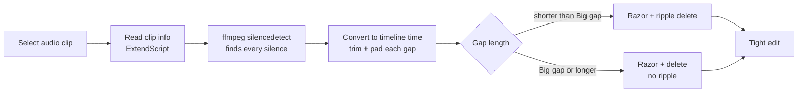

<h1 align="center">✂️ Silence Cut</h1>

<p align="center">
  <b>One click to tighten talking-head audio in Adobe Premiere Pro.</b><br>
  Short breaths and pauses get ripple-deleted. Long gaps get cut out but left open, so your segments stay separate.
</p>

<p align="center">
  
  
  
  
</p>

> ⚠️ **Experimental.** This panel was written with AI assistance. It has been tested on one Premiere Pro build (26.5.2) with a few clips, not enough to call it stable. Try it on a *duplicate* of your sequence. See [Status](#-status) for details.

---

## ✨ What it does

You record a voice-over or talking-head clip. It is full of tiny pauses and breaths, plus a few long breaks where you stopped recording. Cutting all of that by hand is slow.

Silence Cut finds every silence and treats it by length:

| Gap type | Example | What happens |
|---|---|---|
| 🫁 **Small gap** | a breath or short pause (about 8-10 frames) | **Ripple delete.** The gap closes and the edit is tight. |
| ⏸️ **Big gap** | a real break in the recording (seconds long) | **Plain delete.** The hole stays, so the segments stay separated on the timeline. |

```
BEFORE   ▮▮▮▮ ·breath· ▮▮▮▮ ·breath· ▮▮▮▮ ░░░░░░ long gap ░░░░░░ ▮▮▮▮ ·breath· ▮▮▮▮

AFTER    ▮▮▮▮▮▮▮▮▮▮▮▮▮▮▮▮▮▮▮▮▮▮▮▮▮▮▮▮ ░░░░░░ long gap ░░░░░░ ▮▮▮▮▮▮▮▮▮▮▮▮
         └──── breaths ripple-deleted ───┘  └─ hole left open ─┘
```

## 🚀 Quick start

1. [Install](#-install) the panel and **ffmpeg**.
2. Open **Window > Extensions > Silence Cut** in Premiere Pro.
3. Select your audio clip on the timeline.
4. Click **Preview (no edits)** and check the numbers.
5. Click **Cut Silence**.

> 💡 Always **duplicate your sequence first**. Each cut is a separate undo step.

## 🧠 How it works



1. **Detect:** Premiere's scripting cannot read audio levels, so the panel asks ffmpeg to scan the clip's source file for silence.
2. **Map:** silence times in the file are converted into timeline times, respecting where the clip is trimmed.
3. **Classify:** each silence is *small* or *big* by its length.
4. **Cut from the end backward**, so cutting a later gap never moves an earlier one.
5. **Razor, then delete:** the gap is split out with the razor and removed, with or without ripple.

## ⚙️ Settings

Defaults are tuned for voice recordings where breaths sit around **-30 dB** and last about **8-10 frames**, while real recording breaks are digital silence lasting seconds.

| Setting | Default | What it does |
|---|---|---|
| **Silence threshold (dB)** | `-28` | Anything quieter than this counts as silence. It must be *higher* than your breath level, or breaths are not detected. |
| **Min silence (sec)** | `0.2` | Ignore silences shorter than this. About 6 frames at 30 fps. |
| **Big gap from (sec)** | `1.0` | Silences this long or longer are *big* (no ripple). Shorter ones are *small* (ripple). |
| **Padding each side (sec)** | `0.04` | Keeps this much silence next to speech so word endings are not clipped. About 1 frame. |
| **Also cut video tracks** | on | Razors and removes the same range on video tracks so picture stays in sync. |

### 🎛️ Tuning cheatsheet

| What you see | Try |
|---|---|
| Breaths are not being removed | Raise the threshold (for example `-26`) |
| Ends of quiet words are chopped | Lower the threshold (for example `-30`) or raise padding to `0.06` |
| Pauses feel too tight | Raise padding |
| Normal pauses between sentences are treated as big gaps | Raise **Big gap from** |
| Long gaps are being closed instead of left open | Lower **Big gap from** |

## 📦 Install

### Requirements

- Adobe Premiere Pro with CEP panel support
- [ffmpeg](https://ffmpeg.org/download.html) available in your `PATH` (or type its full path into the panel)
- Windows (developed here) or macOS (should work, untested)

### 1. Copy the panel

Put this folder into Premiere's CEP extensions folder (keep the folder name `SilenceCut`):

| OS | Folder |
|---|---|
| Windows | `%APPDATA%\Adobe\CEP\extensions\` |
| macOS | `~/Library/Application Support/Adobe/CEP/extensions/` |

### 2. Allow unsigned panels

This panel is not signed by Adobe, so debug mode has to be on. See the [Security note](#-security-note) below for what this setting does.

**Windows** (Command Prompt):

```bat
for %v in (10 11 12) do reg add "HKCU\Software\Adobe\CSXS.%v" /v PlayerDebugMode /t REG_SZ /d 1 /f
```

**macOS** (Terminal):

```bash
for v in 10 11 12; do defaults write com.adobe.CSXS.$v PlayerDebugMode 1; done
```

### 3. Restart Premiere Pro

Then open **Window > Extensions > Silence Cut**.

## 🔒 Security note

**What `PlayerDebugMode` is.** Premiere Pro normally loads only CEP panels that carry an Adobe-recognised signature. Silence Cut is not signed, so the install steps turn on Adobe's own developer setting, `PlayerDebugMode`, which allows unsigned panels. The `CSXS.10`, `CSXS.11` and `CSXS.12` numbers are CEP versions; different Premiere releases use different ones, which is why the commands set all three.

**What it changes.**

- It is a **per-user** setting (`HKCU` on Windows, your own preferences on macOS), not a system-wide one.
- While it is on, Premiere will load **any** unsigned panel placed in your CEP extensions folder, not only this one. Only install panels from sources you trust.
- Nothing in this repository changes your registry or preferences for you. You run the commands yourself, and they are shown in full above so you can read them first.

**What this panel itself does.**

- It enables Node.js inside the panel so it can start `ffmpeg` on the selected clip's source file.
- It edits the timeline of the open sequence (razor and delete).
- It does not use the network, collect data, or upload anything. The code is small: see `js/main.js` and `host/host.jsx`.

**How to turn the setting off again.** Delete the key when you no longer need unsigned panels.

Windows (Command Prompt):

```bat
for %v in (10 11 12) do reg delete "HKCU\Software\Adobe\CSXS.%v" /v PlayerDebugMode /f
```

macOS (Terminal):

```bash
for v in 10 11 12; do defaults delete com.adobe.CSXS.$v PlayerDebugMode; done
```

Panels that depend on it will then stop appearing until you turn it back on.

## 🛠️ Troubleshooting

| Problem | Fix |
|---|---|
| Panel is missing from the Extensions menu | Re-check step 2 and restart Premiere. The folder must be directly inside `extensions`. |
| `Could not start ffmpeg` | Install ffmpeg, or paste its full path (for example `C:\ffmpeg\bin\ffmpeg.exe`) into the panel. |
| `Select the audio clip(s) on the timeline first.` | Click the audio clip so it is highlighted, then run again. |
| `Nothing found at ...` or `Gap N failed` | The razor or remove step did not match the clip. Copy the log text into a GitHub issue. |
| Video and audio drift apart after cutting | Turn on sync lock for the affected tracks, or lock tracks you do not want touched. |

## ⚠️ Limitations

- Silence is detected on the **source file**, not the timeline mix, so gain changes and effects are not considered.
- Clips with **speed changes** are not supported.
- Select **one clip** (or clips on the same track). Overlapping selections on different tracks are not handled.
- Locked tracks are not detected.
- No crossfade or audio transition is added at the joins (intentional).
- Every cut is its own undo step.


## 🧪 Status

| | |
|---|---|
| Written with | AI assistance (see disclaimer below) |
| Tested in Premiere Pro | **Yes, one build:** Premiere Pro 26.5.2 (Build 5). Preview and Cut on a duplicate sequence (107 gaps cut, 0 not found), export OK. Other versions and clip types untested. |
| Syntax checked | Yes (`main.js`, `host.jsx`) |
| Highest-risk parts | QE DOM `razor` timecode format, whether `remove(true, true)` ripples all synced tracks |

If you try it, please open an issue with your Premiere version, OS, and the panel log. That is the most useful thing you can give this project.

## 🗂️ Project structure

```
SilenceCut/
├── CSXS/
│   └── manifest.xml     # Panel registration, Node.js flags, panel size
├── host/
│   └── host.jsx         # ExtendScript: read selection, razor + remove clips
├── js/
│   └── main.js          # Panel logic: ffmpeg, gap detection and classification
├── index.html           # Panel UI
├── LICENSE
└── README.md
```

## ❓ FAQ

**Why a CEP panel and not a UXP plugin?**
Only CEP gives access to the razor tool (through the undocumented QE DOM) in current Premiere versions. UXP has no razor and no audio transition API.

**Why ffmpeg?**
Premiere's scripting cannot read audio samples. ffmpeg's `silencedetect` filter is a small, reliable way to find silences.

**Does it add audio crossfades?**
No. This was a deliberate choice to keep the tool simple.

**Does it upload anything?**
No. Everything runs locally and the panel does not use the network.

## 🙏 Credits and disclaimer

- **AI disclaimer:** this project was designed with the help of an AI assistant (Claude). The code has not been fully tested in Premiere Pro. Review it before relying on it for important work.
- **[ffmpeg](https://ffmpeg.org/)** performs the silence detection. It is not bundled; install it separately and follow its own license.
- Built on Adobe's CEP panel platform and the Premiere Pro ExtendScript / QE DOM APIs. No Adobe code is included in this repository.
- Adobe and Premiere Pro are trademarks of Adobe. This project is not affiliated with or endorsed by Adobe.

## 📄 License

MIT. See [`LICENSE`](LICENSE).
